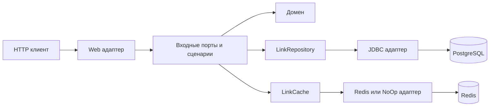

# Shortlinks

Backend для коротких ссылок: создание ссылки со случайным кодом или пользовательским алиасом, редирект и изменение целевого URL.

## Стек

Java 21, Spring Boot 3.5.14, Spring MVC, Bean Validation, Spring JDBC, PostgreSQL 16, Flyway, Redis 7/Lettuce, Resilience4j, springdoc-openapi, Actuator/Micrometer и SLF4J/Logback.

JUnit 5, AssertJ, Mockito, Testcontainers и ArchUnit проверяют приложение; JaCoCo собирает покрытие, Spotless использует google-java-format AOSP.

## Быстрый запуск в Docker

Нужны запущенный Docker Engine/Desktop с Compose v2 и доступ к реестрам образов и Maven Central.

Из корня репозитория подготовьте `.env`.

Затем:

```sh
docker compose up -d --build
docker compose ps
docker compose logs -f app
```

Flyway применяет миграции при старте. Данные PostgreSQL находятся в именованном volume и сохраняются при пересоздании контейнеров.

| Ресурс | Адрес по умолчанию |
| --- | --- |
| API | http://localhost:8080 |
| Swagger UI | http://localhost:8080/swagger-ui/index.html |
| OpenAPI JSON | http://localhost:8080/v3/api-docs |
| Readiness | http://localhost:9090/actuator/health/readiness |
| Liveness | http://localhost:9090/actuator/health/liveness |
| Prometheus | http://localhost:9090/actuator/prometheus |

Для остановки используйте `docker compose down`.

## API

| Метод и путь | Назначение | Успешный ответ |
| --- | --- | --- |
| `POST /api/links` | Создать ссылку; `alias` необязателен | `201`, JSON и `Location` |
| `GET /{code}` | Перенаправить на текущий URL | `302`, `Location`, `Cache-Control: no-store` |
| `PUT /api/links/{code}` | Изменить целевой URL | `200`, актуальный JSON |

Создание:

```sh
curl -i http://localhost:8080/api/links \
  -H 'Content-Type: application/json' \
  -d '{"url":"https://example.org/old","alias":"demo"}'
```

```json
{"code":"demo","url":"https://example.org/old","shortUrl":"http://localhost:8080/demo"}
```

Редирект и обновление:

```sh
curl -i http://localhost:8080/demo
curl -i -X PUT http://localhost:8080/api/links/demo \
  -H 'Content-Type: application/json' \
  -d '{"url":"https://example.org/new"}'
```

Повторное создание алиаса `demo` вернёт `409`. Без поля `alias` генерируется код из семи base62-символов; допускается не более пяти попыток вставки при коллизии.

URL должен быть абсолютным HTTP/HTTPS URL с host, без управляющих символов, длиной до 2048 символов. Алиас содержит 3-32 ASCII-символа `[a-zA-Z0-9_-]`; пустой алиас недопустим. Зарезервированы `api`, `health`, `metrics`, `actuator`, `swagger-ui`, `v3`, без учёта регистра. Сами коды регистрозависимы.

Ошибки возвращаются как ProblemDetail с `requestId`: `400` - некорректный запрос, `404` - ссылка отсутствует, `409` - алиас занят, `503` - недоступна БД или исчерпаны попытки генерации, `500` - неожиданная ошибка. Идентификатор запроса также передаётся в `X-Request-ID`. Сервис не обращается к целевому сайту при создании ссылки.

## Конфигурация

Настройки приложения - [application.yaml](src/main/resources/application.yaml).

| Переменная | Назначение / значение по умолчанию |
| --- | --- |
| `POSTGRES_DB`, `POSTGRES_USER` | БД и пользователь Compose: `shortlinks` |
| `POSTGRES_PASSWORD` | Пароль БД; задаётся явно |
| `PUBLIC_BASE_URL` | Основа `shortUrl`; в Compose `http://localhost:8080`, при запуске Java задаётся явно |
| `APP_PORT`, `MANAGEMENT_PORT` | Публикуемые порты Compose: `8080`, `9090` |
| `DATABASE_URL` | JDBC URL для запуска Java; Compose задаёт адрес сервиса `postgres` |
| `PORT` | HTTP-порт Java-процесса: `8080` |
| `CACHE_ENABLED` | Кеш: в Compose `true`, для Java без переменной `false` |
| `REDIS_HOST`, `REDIS_PORT`, `REDIS_PASSWORD` | Для Java: `localhost`, `6379`, без пароля; Compose использует host `redis` |
| `CACHE_POSITIVE_TTL`, `CACHE_NEGATIVE_TTL` | TTL найденной ссылки и отсутствия: `60s`, `5s` |
| `REDIS_CONNECT_TIMEOUT`, `REDIS_COMMAND_TIMEOUT` | Таймауты Redis: по `200ms` |
| `CACHE_FAILURE_WINDOW`, `CACHE_FAILURE_RATE_THRESHOLD` | Окно circuit breaker: `10` вызовов, порог ошибок `50` процентов |
| `CACHE_OPEN_DURATION`, `CACHE_HALF_OPEN_CALLS` | Открытое состояние: `5s`; пробных вызовов: `2` |
| `API_DOCS_ENABLED` | Публикация OpenAPI/Swagger UI: `true` |
| `JAVA_TOOL_OPTIONS` | JVM-флаги контейнера; пример включает `MaxRAMPercentage=75` |

`PUBLIC_BASE_URL` принимает HTTP/HTTPS origin без credentials, query, fragment и пути. Заголовок Host клиента не используется для формирования короткой ссылки. При смене `APP_PORT` измените и `PUBLIC_BASE_URL`.

## Архитектура и кеш

Корневой пакет - `shortlinks`:

```text
domain/                 значения Link/ShortCode/TargetUrl, предметные ошибки
application/port/       входные сценарии и выходные порты
application/service/    создание, чтение и обновление
adapter/in/web/         HTTP, ProblemDetail, request id
adapter/out/            JDBC, Redis/NoOp-кеш, генератор кодов
dto/                    HTTP-запросы и ответы
config/                 связывание компонентов и настройки
```



Domain зависит только от JDK; application - от JDK, domain и своих портов. Границы проверяет ArchUnit. Миграции находятся в `src/main/resources/db/migration`.

Cache-aside различает найденный URL, отрицательный результат и промах. Создание и обновление сначала изменяют PostgreSQL, затем инвалидируют кеш. Single-flight объединяет одновременные загрузки одного кода внутри процесса. При отказе Redis приложение продолжает работать через БД; Redis не входит в readiness. Отключение кеша:

```sh
CACHE_ENABLED=false docker compose up -d --no-deps --force-recreate app
```

При гонке заполнения кеша после инвалидации либо ошибке удаления возможен старый результат до истечения TTL. Строгая немедленная согласованность при конкуренции не гарантируется.

## Проверки

```sh
./mvnw test              # unit, HTTP-контракты и ArchUnit
./mvnw spotless:apply    # форматирование Java
./mvnw clean verify      # unit + Testcontainers IT, Spotless и JaCoCo ≥70%
scripts/smoke.sh          # HTTP smoke для localhost:8080
scripts/verify-local.sh   # полный локальный функциональный прогон
```

`verify-local.sh` требует `.env`, использует отдельный Compose-проект `shortlinks-verify` и порты `18080`/`19090`. Проверяет создание, редирект, обновление, сохранение данных после пересоздания контейнеров, отказ/восстановление Redis и отключённый кеш. Volumes не удаляет; проверочный экземпляр оставляет запущенным. Порты меняются через `VERIFY_APP_PORT` и `VERIFY_MANAGEMENT_PORT`.

### Покрытие JaCoCo

Объединённый отчёт JaCoCo 0.8.13 учитывает unit и интеграционные тесты. Порог не менее 70% production-строк проверяется Maven; исключения классов в конфигурации JaCoCo не заданы.

| Метрика | Покрытие | Покрыто / всего |
| --- | --- | --- |
| Строки | **94,62%** | **334 / 353** |
| Ветви | 72,31% | 94 / 130 |
| Инструкции | 94,30% | 1439 / 1526 |
| Методы | 97,65% | 83 / 85 |
| Классы с исполняемым кодом | 100% | 30 / 30 |

Объединённые отчёты: `target/site/jacoco/index.html` и `target/site/jacoco/jacoco.xml`. Отдельный unit-отчёт: `target/site/jacoco-unit/index.html`.

### Результаты тестирования

| Проверка | Фактический результат |
| --- | --- |
| Unit, HTTP и ArchUnit | **34 теста: 34 успешных, 0 failures, 0 errors, 0 skipped** |
| Проверяемые сценарии | Доменные ограничения URL/алиаса, создание и коллизии кодов, чтение/обновление, positive/negative cache, single-flight, HTTP-статусы и заголовки, OpenAPI, MDC и границы пакетов |
| Компиляция | Скомпилированы production-код и все тестовые классы |
| Ручная проверка API и Redis | POST вернул 201; GET - 302, правильный Location и no-store; ключ `shortlinks:v1:redis_check` содержал `url:https://example.org/redis-check` с TTL 60 секунд |
| Testcontainers | **10 тестов: 10 успешных, 0 failures, 0 errors, 0 skipped**; PostgreSQL и Redis запущены в Docker |
| Maven verify | **BUILD SUCCESS**, `./mvnw clean verify`, всего 44 успешных теста |
| Compose и shell | Конфигурации Compose и bash -n прошли проверку; пользователь выполнил HTTP smoke с результатом Smoke passed |

## Нагрузка и профилирование

`load/redirects.js` содержит k6-сценарий с прогревом и отдельными метриками измерения; `scripts/cleanup-load.sh` удаляет только синтетические данные указанного прогона. Сценарий предусматривает 15 секунд прогрева и 60 секунд измерения. Измерялись GET-редиректы без перехода по целевому URL; данные распределены равномерно по набору из 1000 алиасов.

### Результаты нагрузочного прогона

Прогон `sla01` выполнен k6 1.2.3 в Docker по сети Compose напрямую к `app:8080`: 20 VU, 15 секунд прогрева и 60 секунд измерения. Проверялись статус `302`, ожидаемый `Location` и `Cache-Control: no-store`. За измеренное окно выполнено **2 613 221** запроса, или около **43 554 редиректов/с**; ошибок проверок редиректа не было. Заданные пороги пройдены: error rate = 0 и p95 < 20 мс.

| Метрика измеренного этапа | Результат |
| --- | ---: |
| Запросы | 2 613 221 |
| Пропускная способность | около 43 554 запросов/с |
| Ошибки проверки редиректа | 0 / 2 613 221 (0%) |
| Средняя задержка HTTP | 0,417 мс |
| p95 | 0,668 мс |
| p99 | 1,114 мс |
| Максимальная задержка HTTP | 19,556 мс |
